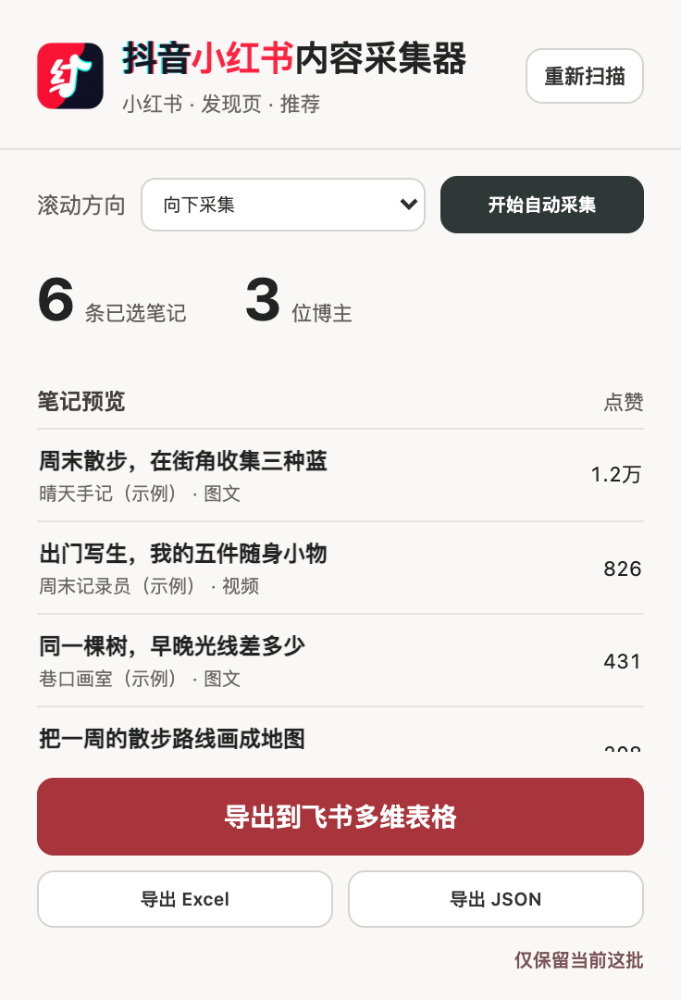
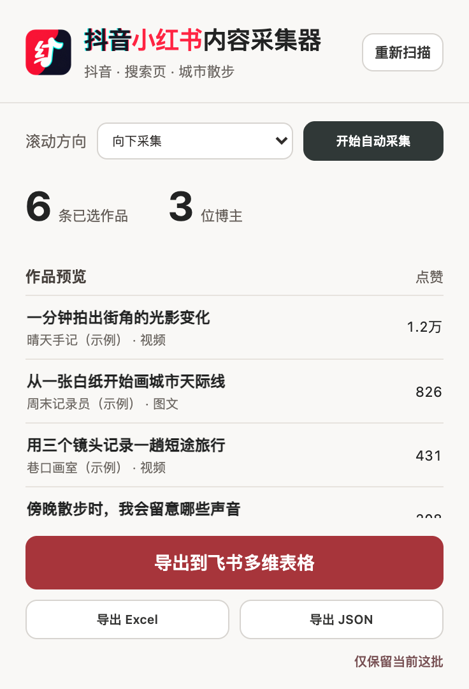
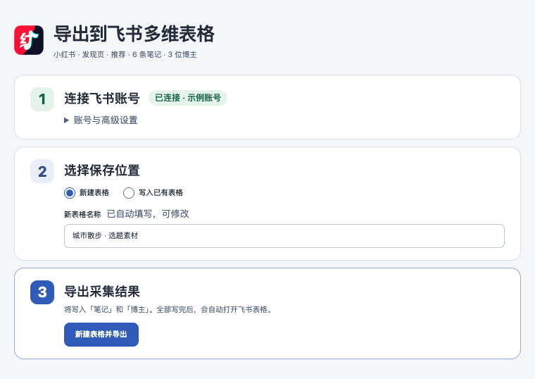

# 抖音小红书内容采集器

把你在抖音、小红书网页上看到的作品，整理到自己的飞书多维表格。在博主主页整理作品清单，在搜索页收集同一选题的素材，都可以边滚动边采集，随时停止。也可以直接下载 Excel 或 JSON。

> 🤖 **第一次使用？** [复制给 AI Agent 的安装指令](#agent-install)　·　[🧩 手动安装](#manual-install)

<p>
  
  
</p>

<sub>截图来自实际插件界面，作品、昵称和数据均为虚构示例。</sub>

<a name="agent-install"></a>

## 🤖 让 AI Agent 帮你安装

**复制下面整段，发给能操作你电脑的 Agent。** 如果已经下载，可以同时附上解压后的项目文件夹。

```text
请帮我在这台电脑的日常 Chrome 安装「抖音小红书内容采集器」。
优先使用我提供的本地安装包。也可以查看 https://github.com/jiamuAi/douyin-xhs-collector/releases ，选择与本机系统和处理器匹配的安装包。解压后运行包内的「安装采集器」，它会把扩展和更新助手安装在当前用户目录，然后显示 Chrome 应加载的「插件」文件夹。
如果只有源码 ZIP，也可以直接加载其中的「插件」目录，使用采集和导出功能。请告诉我装的是哪种方式。
打开日常 Chrome 的扩展程序页，启用开发者模式，通过「加载已解压的扩展程序」选择上述目录。升级已有安装时请保留同一扩展 ID，不要卸载旧扩展或覆盖我的开发仓库。
如果需要我亲自点击，把该点的按钮和完整目录发给我，并在文件管理器中定位。安装后核对版本、工具栏入口，使用安装包时再点一次弹窗底部「检查并更新」。
```

<a name="manual-install"></a>

## 🧩 手动安装

适用于桌面版 Google Chrome 106 或更高版本。安装和采集都无需命令行。

1. **使用带更新助手的安装包。** 解压对应系统和处理器的 ZIP，运行包内的「安装采集器」，记下它显示的**插件文件夹**。可使用维护者提供的试用包，也可在有正式安装包时从 GitHub 下载。[GitHub 发布页](https://github.com/jiamuAi/douyin-xhs-collector/releases)
2. 在 Chrome 地址栏输入 `chrome://extensions/`，打开右上角的**开发者模式**，点**加载已解压的扩展程序**，选择上一步显示的文件夹。
3. 从 Chrome 工具栏的拼图菜单固定**抖音小红书内容采集器**。打开支持的列表页，点图标即可采集。

**以后更新**时，点弹窗底部版本号旁的**检查并更新**。有新正式版会自动下载、校验、安装并重新加载，完成后再打开弹窗就能看到新版号。只需在首次安装时运行安装工具。

只想从源码使用采集和导出，也可以解压后直接加载工程里的 `插件` 文件夹。公开的 v1.5.0 源码版可按这种方式安装。[下载 v1.5.0 源码 ZIP](https://github.com/jiamuAi/douyin-xhs-collector/archive/refs/tags/v1.5.0.zip)


## 🔎 哪些页面能采集

| 平台 | 支持的页面 | 可以得到什么 |
| --- | --- | --- |
| 小红书 | 发现页、博主主页的笔记列表、笔记搜索结果（含支持的 AI 搜索列表） | 笔记标题、原始链接、封面、点赞、作者及其主页。列表提供时，还可补充类型、发布时间、互动数、话题、媒体链接等。 |
| 抖音 | 公开博主主页的「作品」，以及从「推荐」「精选」等入口打开的「综合」「视频」搜索结果 | 视频、图文、文章卡片的标题、链接、封面、点赞。作者资料、置顶、时长和发布时间视页面而定。综合搜索也识别作者横排里能对应到作品的卡片。 |

采集以**页面已展示的卡片**为准。滚动后新出现的卡片会追加，同一作品按 ID 合并。只有预载数据、从未生成卡片的作品不会进入结果。遇到登录或验证提示，先在原网页完成。推荐播放流、单条作品详情和博主的喜欢列表不在支持范围内。

## 📤 第一次采集和导出

1. **打开列表，点插件图标。** 弹窗显示所在页面、内容条数和博主数，可以预览前 30 条。只需要当前这批时，可直接导出。
2. **需要更多时，点「开始自动采集」。** 可选向下、向上或先向上再向下。关掉弹窗仍会继续，可以在原网页右下角随时停止。切换列表或刷新页面前，先导出要保留的结果。
3. **选择导出方式。** 红色主按钮打开飞书导出页。用 Excel 或 JSON 则直接在本机生成文件。

| 导出方式 | 你拿到的结果 |
| --- | --- |
| 飞书多维表格 | 默认在自己的飞书新建一份 Base，也可追加到有写入权限的已有 Base。内容表每行一条作品，博主表按可识别的作者汇总，同一博主的多条作品都会保留。写完自动打开表格。 |
| Excel（.xlsx） | 内容表、博主表和采集说明。整列无值时自动省略，原始链接可点击，点赞排序值可用于排序。 |
| JSON | 保留来源页面、采集时间、作品、作者和媒体链接数组等结构，方便后续分析。 |

### 写入自己的飞书

首次使用，在第 1 步点**连接飞书**，用中国版飞书扫码或打开官方确认页，选择已有应用或新建，再确认账号授权。组织的应用和审批策略可能影响这一步。下次打开导出页，有效的本机连接可以直接复用。

第 2 步默认**新建表格**，名称可以修改。要继续写入旧表，选择**写入已有表格**并粘贴 `/base/` 链接。第 3 步点**新建表格并导出**或**导出到已有表格**，才会把内容写入飞书。导出期间保留此页，写入中断可以按提示继续，已有记录按 ID 跳过。



例如，6 条笔记来自 3 位可识别的博主，内容表就是 6 行，博主表是 3 行。飞书内容表使用类型单选、点赞排序值。有置顶时用「卡片标签」单选表示。作品或笔记链接右侧的**视频文案提取**是预留空列，方便后续手工填写或接入自己的工作流。

## 🔒 数据与隐私

采集和本地文件导出在浏览器内完成。项目没有发布者服务器、统计或广告服务。连接飞书时，凭证保存在本机 Chrome 扩展存储中。执行飞书导出后，所选数据会发送到飞书。导出可能含博主 ID、头像、搜索词以及带访问参数的原始链接，分享文件或表格前请检查这些内容及飞书共享权限。[隐私说明](PRIVACY.md)

## 开发、反馈与许可

扩展为 Manifest V3，源码在 [插件](插件/)，可以直接加载。改完代码，在 Chrome 扩展程序页重新加载并刷新原网页。在根目录用 Node.js 24 运行回归测试。

```sh
node --test 测试/*.test.mjs
```

普通问题可以在仓库 Issues 中附平台、页面类型、Chrome 和插件版本，以及脱敏后的复现步骤。隐私或安全问题请走私密反馈渠道。[参与贡献](CONTRIBUTING.md) · [安全反馈](SECURITY.md)

本项目的原创代码采用 **MIT**，允许商用、修改和再分发，需保留版权与许可声明。随扩展分发的第三方组件各有自己的许可。平台标识与采集到的作品涉及各自权利人。此项目由社区独立开发。[MIT 许可证](LICENSE) · [第三方许可与署名](THIRD_PARTY_NOTICES.md)

遇到加载失败、飞书连接或导出中断时，可以查看[安装与使用指南](安装与使用.md)。
